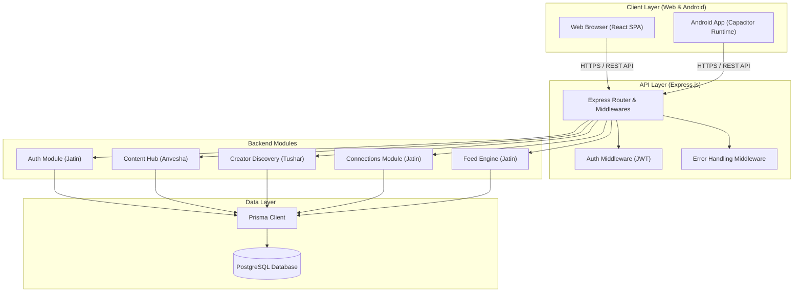
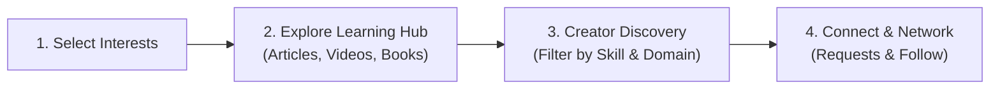

# System Architecture — Ryth Core

> **Problem Statement ID**: 2501010153  
> **Platform Scope**: Web & Android (Capacitor)

---

## 1. High-Level Architecture Overview

Ryth Core is organized as a decoupled monorepo featuring a client-side Single Page Application (with Android hybrid export capability) and a modular REST API backend backed by PostgreSQL.

---

## 2. Core User Journey Flow

---

## 3. Frontend Architecture (`/client`)

The frontend is constructed using **React 18** and **Vite** with **Tailwind CSS** for responsive styling and **React Router** for view navigation.

### Key Architectural Decisions:
1. **Feature-Based Modular Structure**: Rather than grouping all components in a flat folder, logic is co-located by domain:
   - `src/features/content/` (Anvesha Patel)
   - `src/features/creators/` (Tushar Singh)
   - `src/features/connections/` (Jatin)
2. **Centralized HTTP Client**: An Axios singleton (`src/services/api.js`) handles base URLs, request interceptors (attaching Bearer JWT tokens), and global response error interception.
3. **Android Portability via Capacitor**: Mobile wrapper configuration enables building directly to native Android webviews using `@capacitor/core` and `@capacitor/cli` without codebase divergence.

---

## 4. Backend Architecture (`/server`)

The backend follows an **Express.js modular monolith** pattern designed for high cohesion, low coupling, and zero merge conflicts among team members.

### Module Structure:
Each backend module under `src/modules/<name>/` maintains a layered separation of concerns:
- `*.routes.js`: Route definitions, route-level middlewares, and endpoint mapping.
- `*.controller.js`: Request validation, HTTP status orchestration, and calling domain services.
- `*.service.js`: Business logic and database access via the Prisma Client.

### Cross-Cutting Middleware:
- **`auth.js`**: Validates JWT bearer tokens and sets `req.user`.
- **`errorHandler.js`**: Centralized error middleware returning normalized JSON error payloads.

---

## 5. Database & Data Access Layer

- **PostgreSQL**: Selected for strict relational integrity across users, creator profiles, content taxonomies, and connection graphs.
- **Prisma ORM**: Provides type-safe database queries, automated migration management, and schema-driven data modeling.

