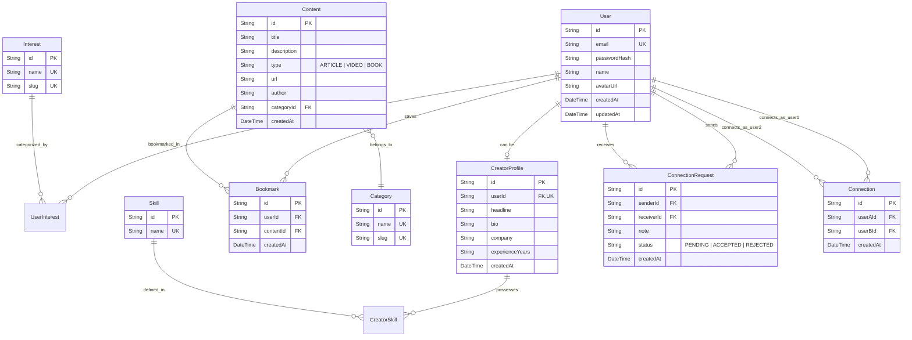

# Database Schema & Entity Relationships — Ryth Core

> **Engine**: PostgreSQL  
> **ORM**: Prisma ORM  
> **Schema Location**: `server/prisma/schema.prisma`

---

## 1. Entity-Relationship Overview

---

## 2. Table Specifications & Ownership

### 2.1 User & Identity Tables (Jatin)
- **`users`**: Core user accounts for both standard learners and creators.
- **`interests`**: Global taxonomy of topics (e.g. `Software Engineering`, `Graphic Design`, `Finance`).
- **`user_interests`**: Many-to-many join table mapping users to their selected learning interests.

### 2.2 Content & Knowledge Hub Tables (Anvesha Patel)
- **`categories`**: Grouping taxonomy for content (e.g., `Engineering`, `Product Management`).
- **`contents`**: Stores educational resources:
  - `type` enum: `ARTICLE`, `VIDEO`, `BOOK`.
  - External links, metadata, author details.
- **`bookmarks`**: User saved resources for later review.

### 2.3 Creator Discovery Tables (Tushar Singh)
- **`creator_profiles`**: Extended profile linked 1:1 to `users`, highlighting professional credentials, current organization, bio, and portfolio links.
- **`skills`**: Directory of technical and domain skills (e.g., `React`, `System Architecture`, `UI/UX`).
- **`creator_skills`**: Join table associating creators with their validated skills.

### 2.4 Connections & Networking Tables (Jatin)
- **`connection_requests`**: Tracks connection invitations, states (`PENDING`, `ACCEPTED`, `REJECTED`), and intro notes.
- **`connections`**: Established bidirectional relationships between two platform members.

---

## 3. Indexing & Optimization Guidelines
- Unique composite index on `(userId, contentId)` in `bookmarks` to prevent duplicate bookmarks.
- Unique composite index on `(senderId, receiverId)` in `connection_requests`.
- Full-text or B-tree indexes on `creators(headline, bio)` and `contents(title)` for performant search.

