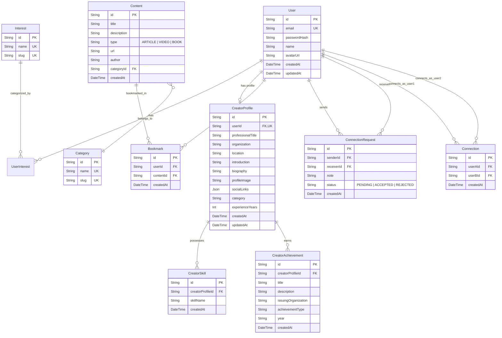

# Database Schema & Entity Relationships — Ryth Core

> **Engine**: PostgreSQL  
> **ORM**: Prisma ORM (v7.x)  
> **Schema Location**: `server/prisma/schema.prisma`  
> **Config Location**: `server/prisma.config.js` (CLI & Migrations)  
> **Client Adapter**: `@prisma/adapter-pg` (`server/src/config/db.js`)

---

## 1. Entity-Relationship Overview



---

## 2. Table Specifications & Ownership

### 2.1 User & Identity Tables (Jatin)
- **`users`**: Core user accounts for both standard learners and creators.
  - `id` (`String` PK, UUID): Unique identifier.
  - `email` (`String` Unique): User email address.
  - `passwordHash` (`String`): Salted & hashed password.
  - `name` (`String`): User's full display name.
  - `avatarUrl` (`String?`): Optional URL to avatar asset.
  - `createdAt` / `updatedAt` (`DateTime`): Account timestamps.
  - **Relation**: 1:1 optional link to `CreatorProfile`.
- **`interests`**: Global taxonomy of topics (e.g. `Software Engineering`, `Graphic Design`, `Finance`).
- **`user_interests`**: Many-to-many join table mapping users to their selected learning interests.

---

### 2.2 Creator Discovery & Profiles Tables (Tushar Singh)

#### `creator_profiles` (`CreatorProfile`)
Stores extended professional identity and domain credentials for verified creators and practitioners.
- **Fields**:
  - `id` (`String` PK, default `uuid()`): Unique profile identifier.
  - `user_id` (`String` Unique FK): Maps directly 1:1 to `users.id` with `onDelete: Cascade`.
  - `professional_title` (`String`): Professional role/headline (e.g., `Staff Cloud Architect`, `Principal AI Scientist`).
  - `organization` (`String?`): Current company or institution (e.g., `Google Cloud`, `DeepMind`, `Figma`).
  - `location` (`String?`): Geographical base (e.g., `Bengaluru, India`, `San Francisco, CA`).
  - `introduction` (`String?` Text): Short editorial intro / tagline.
  - `biography` (`String?` Text): Detailed professional narrative and background.
  - `profile_image` (`String?`): High-resolution profile portrait URL.
  - `social_links` (`Json?`): Structured social URLs (`github`, `linkedin`, `twitter`, `website`, `expertiseAreas`, `experienceHistory`).
  - `category` (`String?`): Creator domain category (e.g., `Cloud & DevOps`, `AI & Machine Learning`, `Frontend & Design`).
  - `experience_years` (`Int?`): Professional experience in years.
  - `created_at` (`DateTime` default `now()`): Record creation timestamp.
  - `updated_at` (`DateTime` updated automatically): Record modification timestamp.
- **Relationships**:
  - `user`: `User` (1:1 relation via `userId`).
  - `skills`: `CreatorSkill[]` (1:N relation).
  - `achievements`: `CreatorAchievement[]` (1:N relation).
- **Constraints & Indexes**:
  - `@unique([userId])`: Ensures each user has at most one creator profile.
  - `@@index([professionalTitle])`: Optimizes searching and filtering by job role.
  - `@@index([location])`: Accelerates regional practitioner filtering.
  - `@@index([category])`: High-speed category filtering in creator discovery.

#### `creator_skills` (`CreatorSkill`)
Stores individual technical, design, and domain competencies for each creator.
- **Fields**:
  - `id` (`String` PK, default `uuid()`): Unique skill entry identifier.
  - `creator_profile_id` (`String` FK): References `creator_profiles.id` with `onDelete: Cascade`.
  - `skill_name` (`String`): Name of the skill (e.g., `Kubernetes`, `PyTorch`, `React`, `Zero Trust`).
  - `created_at` (`DateTime` default `now()`): Creation timestamp.
- **Relationships**:
  - `creatorProfile`: `CreatorProfile` (N:1 relation via `creatorProfileId`).
- **Constraints & Indexes**:
  - `@@unique([creatorProfileId, skillName])`: Prevents duplicate skill tags for the same creator.
  - `@@index([creatorProfileId])`: Fast retrieval of all skills belonging to a creator profile.
  - `@@index([skillName])`: High-speed lookups when filtering creators by specific skills.

#### `creator_achievements` (`CreatorAchievement`)
Stores certifications, awards, open-source milestones, and recognitions earned by a creator.
- **Fields**:
  - `id` (`String` PK, default `uuid()`): Unique achievement record identifier.
  - `creator_profile_id` (`String` FK): References `creator_profiles.id` with `onDelete: Cascade`.
  - `title` (`String`): Title of the achievement (e.g., `CNCF Community Ambassador`).
  - `description` (`String?` Text): Detailed description or impact statement.
  - `issuing_organization` (`String?`): Organization conferring the recognition (e.g., `Cloud Native Computing Foundation`, `MIT Technology Review`).
  - `achievement_type` (`String` default `"AWARD"`): Taxonomy tag (e.g., `CERTIFICATION`, `AWARD`, `PUBLICATION`, `MILESTONE`).
  - `year` (`String?`): Year or date string (e.g., `2025`, `2024`).
  - `created_at` (`DateTime` default `now()`): Creation timestamp.
- **Relationships**:
  - `creatorProfile`: `CreatorProfile` (N:1 relation via `creatorProfileId`).
- **Constraints & Indexes**:
  - `@@index([creatorProfileId])`: Fast lookup of achievements for a creator profile.
  - `@@index([achievementType])`: Enables filtering achievements by certification vs award.

---

### 2.3 Content & Knowledge Hub Tables (Anvesha Patel)
- **`categories`**: Grouping taxonomy for content (e.g., `Engineering`, `Product Management`).
- **`contents`**: Stores educational resources:
  - `type` enum: `ARTICLE`, `VIDEO`, `BOOK`.
  - External links, metadata, author details.
- **`bookmarks`**: User saved resources for later review.

---

### 2.4 Connections & Networking Tables (Jatin)
- **`connection_requests`**: Tracks connection invitations, states (`PENDING`, `ACCEPTED`, `REJECTED`), and intro notes.
- **`connections`**: Established bidirectional relationships between two platform members.

---

## 3. Indexing & Optimization Guidelines
- **Creator Profiles**:
  - `@@index([professionalTitle])` and `@@index([location])` for performant search.
  - `@@index([category])` for fast category filtering across creator listings.
- **Creator Skills**:
  - Composite `@@unique([creatorProfileId, skillName])` ensures data deduplication.
  - B-tree `@@index([skillName])` ensures millisecond-level queries when filtering the creator directory by skill.
- **Creator Achievements**:
  - `@@index([creatorProfileId])` guarantees quick profile page timeline assembly.
  - `@@index([achievementType])` enables filtering achievements by certification vs award.
- **Bookmarks & Connections**:
  - Unique composite index on `(userId, contentId)` in `bookmarks` to prevent duplicate saves.
  - Unique composite index on `(senderId, receiverId)` in `connection_requests`.

---

## 4. Prisma 7 Migration & Seeding Workflow

Ryth Core uses **Prisma ORM 7** configured with `@prisma/adapter-pg` driver adapters in `server/src/config/db.js` and migration configuration in `server/prisma.config.js`.

### 4.1 Schema Validation & Client Generation
```bash
cd server

# Validate schema syntax and relations
npx prisma validate

# Generate updated Prisma Client types and queries
npx prisma generate
```

### 4.2 Applying Migrations
```bash
# Development: create/apply new migrations
npx prisma migrate dev

# Production/Staging: apply all pending migrations
npx prisma migrate deploy
```

### 4.3 Database Seeding
The database seed script (`server/prisma/seed.js`) upserts 8 verified industry practitioner profiles spanning 6 domain categories with realistic skills, achievements, and social credentials:

```bash
cd server

# Using package script (defined in server/package.json)
npm run prisma:seed

# Or direct invocation
node prisma/seed.js
```
The seed execution is idempotent (`upsert` operations based on unique user emails and profile relations), ensuring safe repeated executions without duplicate record creation.
