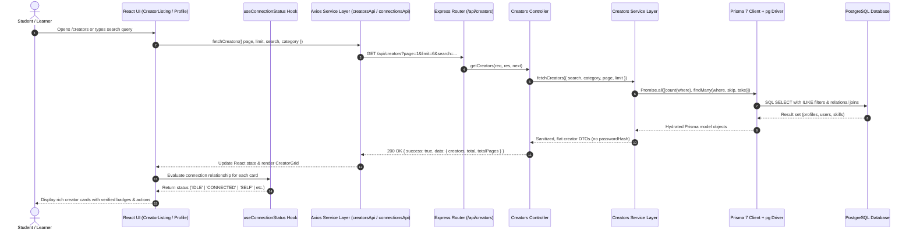
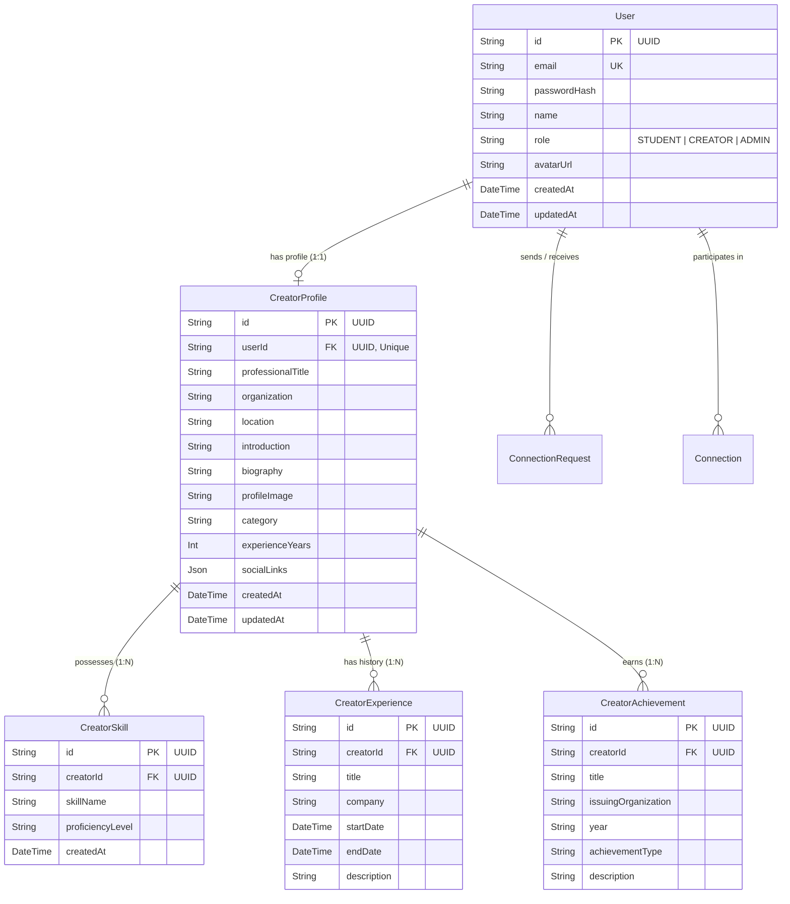

# Module 2 — Creator Discovery & Profiles Documentation

**Course / Project:** Ryth Core — Major University Project (Problem Statement ID: `2501010153`)  
**Module Owner:** Tushar Singh  
**Module Scope:** Module 2 — Creator Discovery & Detailed Profiles  
**Platforms:** Web (React + Vite) & Mobile (Capacitor 8.6: Android & iOS)  
**Last Updated:** Day 5 — Phase 2 Final Submission Preparation  

---

## Table of Contents
1. [Module Overview & Objectives](#1-module-overview--objectives)
2. [Creator Discovery Architecture & Data Flow](#2-creator-discovery-architecture--data-flow)
3. [Frontend Component Hierarchy & Structure](#3-frontend-component-hierarchy--structure)
4. [Backend Service & Controller Structure](#4-backend-service--controller-structure)
5. [Database Models & Relational Schema](#5-database-models--relational-schema)
6. [Creator Listing & Dynamic Pagination](#6-creator-listing--dynamic-pagination)
7. [Multi-Field Keyword Search](#7-multi-field-keyword-search)
8. [Domain Category Filtering & Sorting](#8-domain-category-filtering--sorting)
9. [Creator Profile Functionality](#9-creator-profile-functionality)
10. [Skills, Experience & Achievements Showcase](#10-skills-experience--achievements-showcase)
11. [Published Content Showcase Integration](#11-published-content-showcase-integration)
12. [Live Connect Action & Networking Integration](#12-live-connect-action--networking-integration)
13. [API Endpoints Specification](#13-api-endpoints-specification)
14. [Defensive Engineering, Error Handling & Edge Cases](#14-defensive-engineering-error-handling--edge-cases)
15. [Regression Testing Documentation (88 Test Cases)](#15-regression-testing-documentation-88-test-cases)
16. [Screenshots & Submission Evidence Checklist](#16-screenshots--submission-evidence-checklist)

---

## 1. Module Overview & Objectives

### Problem Statement & Mission
In modern multidisciplinary education, learners need more than static learning material; they require direct visibility into real-world practitioners, researchers, and domain leaders who shape those technologies. **Module 2 (Creator Discovery & Profiles)** establishes the core discovery bridge of the Ryth Core journey:

$$\text{User Interest} \longrightarrow \text{Content Learning} \longrightarrow \mathbf{\text{Creator Discovery (Module 2)}} \longrightarrow \text{Real-World Connection}$$

### Core Objectives
1. **Curated Directory Experience:** Present a high-performance, accessible, and responsive directory of vetted industry practitioners categorized across 6 primary engineering domains.
2. **Multi-Attribute Search & Discovery:** Enable seamless exploration through instantaneous debounced searching across creator names, credentials, organizations, biographies, and granular technical skill tags.
3. **Comprehensive Professional Profiles:** Render deep practitioner profiles including rich editorial biographies, chronological career timelines, verified certifications, domain achievements, and skill matrices.
4. **Decoupled Educational Content Showcase:** Present creator-authored knowledge resources (articles, video lectures, and technical books) without allowing content fetching errors or latency to block profile discovery.
5. **Real-World Networking Integration:** Provide integrated bidirectional connection actions (`Connect`, `Pending`, `Connected`, `Accept Request`, `You`) hooked into the backend authentication and connections ecosystem.
6. **Cross-Platform Parity:** Deliver identical, touch-optimized experiences across desktop web, tablet viewports, mobile browsers, native Android (Capacitor), and native iOS (Xcode 27 UIScene).

---

## 2. Creator Discovery Architecture & Data Flow

Module 2 follows a clean, decoupled 3-tier architecture separating presentation components, business logic services, and database persistence layers.



### Key Architectural Decisions
- **Stale-Response Protection:** Both `CreatorListingPage` and `CreatorProfilePage` implement cancellation flags (`let ignore = false; return () => { ignore = true; };`) inside `useEffect` lifecycles. If a user rapidly updates filters or switches profiles, late-resolving promises are cleanly discarded, preventing race conditions.
- **Selective Column Queries:** Database queries explicitly select only necessary fields via Prisma `select` blocks. Sensitive user attributes (`passwordHash`, reset tokens) are completely excluded at the database projection layer.
- **Parallel Relational Execution:** Listing and counting operations run in parallel via `Promise.all([count, findMany])`, cutting database query round-trip latency in half.
- **Decoupled Profile Content:** Knowledge items are queried via an independent sub-route (`GET /api/creators/:id/content`). If the content subsystem is undergoing maintenance or returns empty, the primary profile remains fully interactive.

---

## 3. Frontend Component Hierarchy & Structure

All frontend logic for Module 2 resides under `client/src/features/creators/`:

```
client/src/features/creators/
├── components/
│   ├── CategoryFilter.jsx          # Domain pill carousel with touch-pan and active states
│   ├── ConnectButton.jsx           # Multi-state connection action button & inline alerts
│   ├── CreatorCard.jsx             # Directory practitioner card with tags, avatar, & actions
│   ├── CreatorGrid.jsx             # Responsive card grid with skeleton, error, & empty states
│   ├── CreatorSearch.jsx           # Search input with 16px font, clear action, & submit button
│   ├── HeroArtwork.jsx             # Editorial geometric visual hero artwork
│   ├── ProfileAbout.jsx            # Multi-paragraph biography and areas of expertise
│   ├── ProfileAchievements.jsx     # Structured honors, certifications, and awards grid
│   ├── ProfileContentShowcase.jsx  # Creator publications showcase with type tabs & cards
│   ├── ProfileExperience.jsx       # Chronological career timeline with node styling
│   ├── ProfileHeader.jsx           # Profile header with avatar, domain badge, social links
│   └── ProfileSkills.jsx           # Technical skill badges grouped by domain category
├── constants/
│   └── categories.js               # Verified domain categories matching PostgreSQL enum
├── hooks/
│   └── useConnectionStatus.js      # React hook managing connection state machine & actions
├── pages/
│   ├── CreatorListingPage.jsx      # Main creator directory page with filters & pagination
│   └── CreatorProfilePage.jsx      # Comprehensive creator profile page with 2-col layout
├── services/
│   ├── connectionsApi.js           # API client for Jatin's connection networking endpoints
│   └── creatorsApi.js              # API client for creator discovery and content endpoints
└── utils/
    └── externalLink.js             # Capacitor Browser vs web window.open delegator
```

### Component Details

| Component | Responsibility | Key Props |
| :--- | :--- | :--- |
| `CreatorListingPage` | Orchestrates directory state (search debounce, category, sort, page) and fetches creator records. | None (Route Page) |
| `CreatorSearch` | Accessible text search input with submit trigger and clear button. 16px font prevents mobile iOS auto-zoom. | `searchTerm`, `onSearchChange`, `onClear`, `onSearchSubmit` |
| `CategoryFilter` | Domain filter pills with SVG icons, horizontal scroll snapping, and `aria-pressed` accessibility. | `categories`, `selectedCategory`, `onSelectCategory` |
| `CreatorGrid` | Layout container rendering animated skeletons, error alerts with retry, empty state, or creator cards. | `creators`, `isLoading`, `error`, `onRetry`, `onViewProfile`, `onResetFilters`, `connectionsData` |
| `CreatorCard` | Presentation card with domain accent bar, avatar fallback, truncated bio, skills, and Connect button. | `creator`, `onViewProfile`, `connectionsData` |
| `CreatorProfilePage` | Detailed creator page orchestrating profile data, content showcase, breadcrumb, and sidebar callout. | None (Route Page with `:id` param) |
| `ProfileHeader` | Sticky-compatible top hero card with large avatar, role, company, location, social links, and Connect. | `creator`, `connectionsData`, `onConnectionActionSuccess` |
| `ProfileAbout` | Editorial multi-paragraph narrative biography and "Areas of Expertise" checkmark grid. | `creator` |
| `ProfileExperience`| Vertical timeline with accent nodes, roles, company names, date periods, and descriptions. | `experienceHistory` |
| `ProfileAchievements`| 2-column grid displaying verified honors, certifications, and publications with date badges. | `achievements` |
| `ProfileContentShowcase`| Independent content showcase with type filter tabs (`All`, `Articles`, `Videos`, `Books`). | `creatorName`, `content`, `isLoading`, `error`, `onRetry` |
| `ProfileSkills` | Clean tag container rendering all technical skills with category domain badge. | `skills`, `category` |
| `ConnectButton` | Accessible button with 6 distinct states, spinner animation, and non-clipping toast messages. | `userId`, `creatorName`, `variant`, `connectionsData`, `onStatusChange`, `onActionSuccess` |

---

## 4. Backend Service & Controller Structure

Backend implementation resides under `server/src/modules/creators/`:

```
server/src/modules/creators/
├── creators.controller.js  # HTTP request parsing, status codes, and error passing
├── creators.routes.js      # Express router mounting endpoints in strict precedence order
└── creators.service.js     # Prisma database queries, input validation, and DTO mappings
```

### Route Precedence in `creators.routes.js`
In Express, parameterized routes (`/:id`) can accidentally match static routes if not ordered carefully. `creators.routes.js` strictly orders routes from specific to parameterized:
1. `GET /api/creators` (Listing)
2. `GET /api/creators/search` (Search endpoint before `/:id`)
3. `GET /api/creators/:id/content` (Sub-resource before `/:id`)
4. `GET /api/creators/:id` (Parametric profile lookup)

### Layered Separation of Concerns
1. **Controller Layer (`creators.controller.js`):** Extracts parameters from `req.query` and `req.params`, delegates execution to the service layer, wraps responses in standard `{ success: true, data, message }` JSON envelopes, and delegates exceptions to Express centralized `errorHandler`.
2. **Service Layer (`creators.service.js`):**
   - Validates UUIDs using `UUID_REGEX = /^[0-9a-f]{8}-[0-9a-f]{4}-[0-9a-f]{4}-[0-9a-f]{4}-[0-9a-f]{12}$/i`.
   - Validates positive integer pagination parameters (`page >= 1`, `limit >= 1`).
   - Dynamically constructs Prisma `where` clause arrays.
   - Executes parallel database queries to prevent $N+1$ query overhead.
   - Normalizes database models into consistent client DTOs.

---

## 5. Database Models & Relational Schema

The PostgreSQL database schema is managed via Prisma ORM 7 (`server/prisma/schema.prisma`):



### Key Schema Characteristics
- **Dual UUID Separation:**
  - `CreatorProfile.id`: Used exclusively for public routing and profile viewing (`/creators/:id`).
  - `User.id`: Used for identity, authentication, and connection networking (`receiverId`).
  - `fetchCreatorById` supports lookup by **either** `id` or `userId`, ensuring complete resilience across frontend components.
- **Relational Integrity:**
  - `CreatorSkill`, `CreatorExperience`, and `CreatorAchievement` have `onDelete: Cascade` foreign keys referencing `CreatorProfile.id`.
- **JSON Metadata:**
  - `CreatorProfile.socialLinks` stores structured JSON metadata including `github`, `linkedin`, `twitter`, `website`, `expertiseAreas`, and `experienceHistory`.

---

## 6. Creator Listing & Dynamic Pagination

### Implementation Details
- **Default Page Size:** 6 cards per page (`pageSize = 6`), fitting cleanly into a 3-column responsive grid without leaving orphan cards.
- **Prisma Offset Query:**
  ```javascript
  const skip = (pageNum - 1) * limitNum;
  const take = limitNum;
  const [total, profiles] = await Promise.all([
    prisma.creatorProfile.count({ where }),
    prisma.creatorProfile.findMany({ where, skip, take, orderBy: { createdAt: 'asc' }, select: { ... } })
  ]);
  ```
- **Boundary Clamping:** The frontend disables previous button when `currentPage <= 1` and next button when `currentPage >= totalPages`.
- **Ellipsis Pagination Logic:** When `totalPages > 5`, `paginationItems` dynamically inserts `...` spacers between the first, active, and last pages.

---

## 7. Multi-Field Keyword Search

### Search Capabilities
The search engine matches queries against 6 database fields using case-insensitive partial matching (`contains` with `mode: 'insensitive'`):
1. `User.name` (e.g., "Elena", "Marcus", "Aarav")
2. `CreatorProfile.professionalTitle` (e.g., "Staff Cloud Architect", "Design Systems Lead")
3. `CreatorProfile.organization` (e.g., "Google Cloud", "Figma", "Stripe", "Vercel")
4. `CreatorProfile.biography` (e.g., "distributed systems", "accessibility primitives")
5. `CreatorProfile.introduction` (e.g., "zero-trust architectures")
6. `CreatorSkill.skillName` via relation filter `skills: { some: { skillName: { contains, mode: 'insensitive' } } }` (e.g., "Kubernetes", "Rust", "React")

### Usability Features
- **350ms Debounce:** Prevents excessive database load while typing.
- **Instant Search:** Pressing `Enter` or clicking the `Search ->` button triggers immediate search without waiting for the debounce timer.
- **Clear Button:** Single-click clear button resets input, restores directory listing, and resets pagination to page 1.
- **Mobile-Friendly Input:** Explicit `text-base` (16px) styling prevents mobile Safari and Android WebViews from zooming in automatically on focus.

---

## 8. Domain Category Filtering & Sorting

### Verified Domain Categories
Matching the exact seeded records in PostgreSQL:
1. `All` (Displays all 8 seeded practitioners)
2. `AI & Machine Learning` (2 practitioners: Dr. Priya Nambiar, Kavita Sundaram)
3. `Cloud & DevOps` (1 practitioner: Aarav Sharma)
4. `Frontend & Design` (2 practitioners: Marcus Vance, Rohan Mehra)
5. `Backend & Systems` (1 practitioner: Vikram Sengupta)
6. `Cybersecurity` (1 practitioner: Neha Kapoor)
7. `Product & Tech Leadership` (1 practitioner: Elena Rostova)

### Category Styling Themes
`DOMAIN_THEMES` provides distinct, accessible badges and vertical accent bars:
- `Cloud & DevOps`: Sage background (`#DCE8E0`), Forest Green text (`#28634F`)
- `AI & Machine Learning`: Warm Amber background (`#F9EDE0`), Cognac text (`#B87A36`)
- `Frontend & Design`: Emerald Mint background (`#E1EFE7`), Forest text (`#28634F`)
- `Backend & Systems`: Steel Blue background (`#EAF1F8`), Slate Navy text (`#346585`)
- `Cybersecurity`: Coral Blush background (`#FCEEEA`), Rust text (`#B84E3C`)
- `Product & Tech Leadership`: Honey Gold background (`#F8EED9`), Bronze text (`#9A7028`)

### Client-Side Sorting
- **Relevance:** Default order from database (`createdAt asc`).
- **Experience (High to Low):** Numerical sort by `experienceYears` descending.
- **Name (A-Z):** Lexicographical sort by `name` ascending.
- **Scope Awareness:** Displays `(Current page only)` badge when sorting paginated results.

---

## 9. Creator Profile Functionality

### Dynamic Routing & Lookup
- Route: `/creators/:id`
- Supported IDs: Accepts either `CreatorProfile.id` or `User.id` (UUID format).
- Fast-Fail: Malformed IDs (non-UUID) immediately trigger the Not Found view without executing unnecessary network requests.

### Defensive Mapping (`safeCreator`)
To protect against database records with null or missing optional fields, `safeCreator` memoizes safe fallbacks:
```javascript
const safeCreator = useMemo(() => {
  if (!creator) return null;
  return {
    ...creator,
    name: creator.name || 'Practitioner',
    role: creator.role || creator.professionalTitle || 'Creator',
    company: creator.company || creator.organization || '',
    detailedBio: Array.isArray(creator.detailedBio) && creator.detailedBio.length > 0
      ? creator.detailedBio
      : (creator.bio ? [creator.bio] : []),
    skills: Array.isArray(creator.skills) ? creator.skills : [],
    achievements: Array.isArray(creator.achievements) ? creator.achievements : [],
    socialLinks: creator.socialLinks && typeof creator.socialLinks === 'object' ? creator.socialLinks : {},
  };
}, [creator]);
```

### Loading, Error & Not Found States
1. **Loading Skeleton (`ProfileSkeleton`):** Animated shimmer matching the exact 2-column layout and card dimensions of the live profile.
2. **Error View:** Distinguishes between 404 (Not Found) and 500/network failures. Includes a prominent `Retry` button and `Back to Creators` navigation.
3. **Not Found View:** Friendly editorial empty state with a return link to `/creators`.

---

## 10. Skills, Experience & Achievements Showcase

### Professional Experience Timeline (`ProfileExperience.jsx`)
- Renders chronological career milestones.
- Styled with vertical connecting lines (`#DCE8E0`) and circular accent nodes with hover micro-interactions.
- Displays job role, company name, date range badge, and narrative description.

### Verified Achievements (`ProfileAchievements.jsx`)
- Renders structured cards for honors, awards, publications, and certifications.
- Includes badge indicators for calendar years (`#D9A66C`) and SVG achievement icons.

### Technical Skill Matrix (`ProfileSkills.jsx`)
- Displays granular technology tags (e.g. `Kubernetes`, `PyTorch`, `React`, `Rust`, `PostgreSQL`).
- Styled with ivory surfaces (`#F8F7F2`), subtle borders (`#E5E3DC`), and hover border highlights.

---

## 11. Published Content Showcase Integration

### Decoupled Content Architecture
- Route: `GET /api/creators/:id/content`
- Handled independently from the profile loading lifecycle.
- Latency or errors from the content service do not block profile rendering.

### Content Types Supported
- `ARTICLE` (Emerald badge, article icon)
- `VIDEO` (Amber badge, video camera icon)
- `BOOK` (Steel blue badge, open book icon)
- `RESOURCE` (Neutral badge, document icon)

### Integration Status with Teammate Module
- Currently, Anvesha Patel's Content Hub backend returns `501 NOT_IMPLEMENTED` or empty lists for creator content.
- `ProfileContentShowcase.jsx` handles this gracefully:
  - If empty: Renders an editorial empty state (`"{creatorName} has not published articles, videos, or books yet."`) with a direct CTA link to `/content`.
  - If content items are provided: Renders a responsive 2-column grid with type filter tabs and external/internal navigation links.

---

## 12. Live Connect Action & Networking Integration

### Multi-State Connection State Machine (`useConnectionStatus.js`)

| Status | Condition | Button Label / Appearance | Action on Click |
| :--- | :--- | :--- | :--- |
| `UNAUTHENTICATED` | No valid JWT token in `localStorage` | `"Sign in to Connect"` (White button, green border) | Navigates to `/login` |
| `SELF` | Current user ID matches creator's `userId` | `"Your Profile"` / `"You"` (Disabled gray pill) | None (Disabled) |
| `IDLE` | No relationship exists between users | `"Connect"` (Solid forest green `#28634F`, white text) | Dispatches `POST /api/connections/request` with `{ receiverId }` |
| `PENDING_SENT` | Current user already sent a pending request | `"Pending"` (Disabled soft ivory pill with clock icon) | None (Disabled) |
| `PENDING_RECEIVED` | Creator previously sent user a request | `"Accept Request"` (Solid forest green, check icon) | Dispatches `PATCH /api/connections/:id` |
| `CONNECTED` | Both users have an accepted connection | `"Connected"` (Soft sage `#EBF3EE`, green check icon) | None (Disabled) |

### Parameter Naming Investigation: `targetUserId` vs. `receiverId`
During integration testing and regression reporting, an apparent parameter naming discrepancy was investigated:
- **Frontend Component / Hook Variable (`targetUserId`):**
  - In `CreatorCard.jsx` and `ProfileHeader.jsx`, the prop passed is `userId={creator.userId}`.
  - In `ConnectButton.jsx`, this is passed to `useConnectionStatus(userId, ...)`.
  - Inside `useConnectionStatus.js`, the argument is named `targetUserId` for semantic clarity (representing the target practitioner's `User.id` UUID).
- **Network Boundary Payload (`receiverId`):**
  - Inside `client/src/features/creators/services/connectionsApi.js` (line 10), `sendConnectionRequest` accepts `receiverId` and constructs the HTTP POST JSON body:
    ```javascript
    export const sendConnectionRequest = async (receiverId, note = null) => {
      const payload = { receiverId };
      if (note && typeof note === 'string' && note.trim()) {
        payload.note = note.trim();
      }
      const response = await api.post('/connections/request', payload);
      return response.data;
    };
    ```
- **Backend Controller Requirement (`receiverId`):**
  - In Jatin's backend (`server/src/modules/connections/connections.controller.js` line 6):
    `const { receiverId, note } = req.body;`
  - In Jatin's service (`server/src/modules/connections/connections.service.js` line 10):
    `export const createConnectionRequest = async (senderId, receiverId, note) => { ... }`
- **Conclusion & Resolution:**
  - The actual over-the-wire JSON request body property is strictly **`receiverId`**.
  - Any reference to `targetUserId` in earlier regression text referred to the internal JavaScript variable name within `useConnectionStatus.js`.
  - Jatin's backend code is preserved untouched, and the API documentation reflects `{ "receiverId": "<uuid>", "note": "..." }` as the exact wire contract.

### Non-Clipping Accessible Feedback
When a request succeeds or fails, `ConnectButton.jsx` renders an accessible tooltip/toast (`role="status"` or `role="alert"`) positioned above the button with `bottom-full mb-2`, ensuring parent card borders (`overflow-hidden`) never clip the message.

---

## 13. API Endpoints Specification

### 1. `GET /api/creators`
Retrieves a paginated list of creator profiles with optional search and category filters.

- **Query Parameters:**
  - `page` *(optional, integer, default: 1)*: Page number.
  - `limit` *(optional, integer, default: 10)*: Number of items per page.
  - `search` *(optional, string)*: Partial match across name, title, organization, bio, introduction, or skills.
  - `category` *(optional, string)*: Exact match domain category (e.g., `Cloud & DevOps`, `All`).
  - `skill` *(optional, string)*: Filter creators possessing a specific skill tag.

- **Response (200 OK):**
  ```json
  {
    "success": true,
    "data": {
      "creators": [
        {
          "id": "1eb08dc3-f87d-4634-8117-477a8fa48e46",
          "userId": "92ea7949-c1d0-424b-bbca-7ef8652613d9",
          "name": "Aarav Sharma",
          "role": "Staff Cloud Architect",
          "company": "Google Cloud",
          "location": "Bengaluru, India",
          "avatar": "https://images.unsplash.com/...",
          "profileImage": "https://images.unsplash.com/...",
          "headline": "Architecting planetary-scale distributed cloud systems...",
          "bio": "Specializing in planetary-scale distributed systems...",
          "category": "Cloud & DevOps",
          "skills": ["Kubernetes", "GCP", "Terraform", "Go", "Distributed Systems"],
          "experienceYears": 9,
          "contentCount": 0
        }
      ],
      "total": 8,
      "page": 1,
      "totalPages": 2
    },
    "message": "Creators retrieved successfully"
  }
  ```

- **Error Response (400 Bad Request):**
  ```json
  {
    "success": false,
    "error": {
      "code": "BAD_REQUEST",
      "message": "Invalid page parameter: must be a positive integer"
    }
  }
  ```

---

### 2. `GET /api/creators/search`
Dedicated search endpoint querying practitioner credentials and skills.

- **Query Parameters:**
  - `query` or `q` *(optional, string)*: Search keyword.
  - `skill` *(optional, string)*: Skill tag filter.
  - `expertise` *(optional, string)*: Category / domain filter.

- **Response (200 OK):**
  ```json
  {
    "success": true,
    "data": {
      "results": [
        {
          "id": "1eb08dc3-f87d-4634-8117-477a8fa48e46",
          "userId": "92ea7949-c1d0-424b-bbca-7ef8652613d9",
          "name": "Aarav Sharma",
          "role": "Staff Cloud Architect",
          "company": "Google Cloud",
          "location": "Bengaluru, India",
          "avatar": "https://images.unsplash.com/...",
          "category": "Cloud & DevOps",
          "skills": ["Kubernetes", "GCP", "Terraform"],
          "experienceYears": 9
        }
      ],
      "query": "Kubernetes",
      "count": 1
    },
    "message": "Creator search executed successfully"
  }
  ```

---

### 3. `GET /api/creators/:id`
Retrieves a single creator's full profile by UUID (`CreatorProfile.id` or `User.id`).

- **Path Parameters:**
  - `id` *(required, UUID string)*: Unique identifier.

- **Response (200 OK):**
  ```json
  {
    "success": true,
    "data": {
      "creator": {
        "id": "1eb08dc3-f87d-4634-8117-477a8fa48e46",
        "userId": "92ea7949-c1d0-424b-bbca-7ef8652613d9",
        "name": "Aarav Sharma",
        "email": "aarav.sharma@example.com",
        "role": "Staff Cloud Architect",
        "company": "Google Cloud",
        "location": "Bengaluru, India",
        "avatar": "https://images.unsplash.com/...",
        "headline": "Architecting planetary-scale distributed cloud systems...",
        "bio": "Specializing in planetary-scale distributed systems...",
        "detailedBio": [
          "Aarav is a Staff Cloud Architect at Google Cloud...",
          "He is a frequent keynote speaker at KubeCon...",
          "When not optimizing cluster topologies..."
        ],
        "category": "Cloud & DevOps",
        "experienceYears": 9,
        "expertiseAreas": [
          "Multi-Region Cloud Topology",
          "Kubernetes Infrastructure & Operators"
        ],
        "experienceHistory": [
          {
            "role": "Staff Cloud Architect",
            "company": "Google Cloud",
            "period": "2022 — Present",
            "description": "Leading strategic architectural design..."
          }
        ],
        "socialLinks": {
          "github": "https://github.com",
          "linkedin": "https://linkedin.com",
          "twitter": "https://twitter.com",
          "website": "https://aaravsharma.dev"
        },
        "skills": ["Kubernetes", "GCP", "Terraform", "Go"],
        "achievements": [
          {
            "id": "82f8a48b-37d4-4bb8-86d1-cc04e0e4b85c",
            "title": "CNCF Community Ambassador",
            "issuer": "Cloud Native Computing Foundation",
            "year": "2025",
            "achievementType": "HONOR",
            "description": "Recognized for pioneering open-source cloud native workshops."
          }
        ],
        "contentCount": 0,
        "createdAt": "2026-11-08T07:22:45.000Z",
        "updatedAt": "2026-11-08T07:22:45.000Z"
      }
    },
    "message": "Creator profile retrieved successfully"
  }
  ```

- **Error Response (404 Not Found):**
  ```json
  {
    "success": false,
    "error": {
      "code": "NOT_FOUND",
      "message": "Creator with ID '00000000-0000-0000-0000-000000000000' not found"
    }
  }
  ```

---

### 4. `GET /api/creators/:id/content`
Retrieves published or curated educational content for a specific creator.

- **Path Parameters:**
  - `id` *(required, UUID string)*: Creator unique identifier.

- **Response (200 OK):**
  ```json
  {
    "success": true,
    "data": {
      "creatorId": "1eb08dc3-f87d-4634-8117-477a8fa48e46",
      "creatorName": "Aarav Sharma",
      "content": [],
      "count": 0
    },
    "message": "Creator content retrieved successfully"
  }
  ```

- **Error Response (404 Not Found):**
  ```json
  {
    "success": false,
    "error": {
      "code": "NOT_FOUND",
      "message": "Creator with ID 'invalid-id' not found"
    }
  }
  ```

---

### 5. `POST /api/connections/request` *(Consumed Endpoint)*
Dispatches a new connection request to a creator/practitioner using their `User.id` UUID.

- **Headers:**
  - `Authorization: Bearer <JWT_TOKEN>`
  - `Content-Type: application/json`

- **Request Body:**
  ```json
  {
    "receiverId": "92ea7949-c1d0-424b-bbca-7ef8652613d9",
    "note": "Hi Aarav, I would love to connect and learn more about Kubernetes platform engineering."
  }
  ```
  *(Note: `receiverId` must be the creator's `User.id`, not `CreatorProfile.id`)*

- **Response (201 Created):**
  ```json
  {
    "success": true,
    "data": {
      "id": "7b58c42a-9f44-42ea-a9c1-58d044f51e18",
      "senderId": "58685dcd-a036-4117-89fe-b4ae6ee944d7",
      "receiverId": "92ea7949-c1d0-424b-bbca-7ef8652613d9",
      "status": "PENDING",
      "note": "Hi Aarav, I would love to connect and learn more about Kubernetes platform engineering.",
      "createdAt": "2026-11-13T16:00:00.000Z"
    }
  }
  ```

- **Error Responses:**
  - `400 Bad Request` (`SELF_REQUEST`):
    ```json
    { "success": false, "error": { "code": "SELF_REQUEST", "message": "You cannot connect with yourself" } }
    ```
  - `404 Not Found` (`USER_NOT_FOUND`):
    ```json
    { "success": false, "error": { "code": "USER_NOT_FOUND", "message": "Receiver not found" } }
    ```
  - `409 Conflict` (`ALREADY_CONNECTED`):
    ```json
    { "success": false, "error": { "code": "ALREADY_CONNECTED", "message": "You are already connected" } }
    ```
  - `409 Conflict` (`REQUEST_ALREADY_EXISTS`):
    ```json
    { "success": false, "error": { "code": "REQUEST_ALREADY_EXISTS", "message": "A connection request already exists between these users" } }
    ```

---

### 6. `GET /api/connections` *(Consumed Endpoint)*
Retrieves all established connections, outgoing sent requests, and incoming received requests for the authenticated user.

- **Headers:**
  - `Authorization: Bearer <JWT_TOKEN>`

- **Response (200 OK):**
  ```json
  {
    "success": true,
    "data": {
      "connections": [],
      "sentRequests": [
        {
          "id": "7b58c42a-9f44-42ea-a9c1-58d044f51e18",
          "senderId": "58685dcd-a036-4117-89fe-b4ae6ee944d7",
          "receiverId": "92ea7949-c1d0-424b-bbca-7ef8652613d9",
          "status": "PENDING",
          "createdAt": "2026-11-13T16:00:00.000Z"
        }
      ],
      "receivedRequests": []
    }
  }
  ```

---

### 7. `PATCH /api/connections/:id` *(Consumed Endpoint)*
Responds to an incoming connection request by accepting or rejecting it.

- **Headers:**
  - `Authorization: Bearer <JWT_TOKEN>`
  - `Content-Type: application/json`

- **Request Body:**
  ```json
  {
    "status": "ACCEPTED"
  }
  ```
  *(Accepted values: `"ACCEPTED"` or `"REJECTED"`)*

- **Response (200 OK):**
  ```json
  {
    "success": true,
    "data": {
      "id": "7b58c42a-9f44-42ea-a9c1-58d044f51e18",
      "status": "ACCEPTED",
      "updatedAt": "2026-11-13T16:05:00.000Z"
    }
  }
  ```

---

## 14. Defensive Engineering, Error Handling & Edge Cases

| Scenario / Edge Case | Defensive Mechanism | Observed Outcome |
| :--- | :--- | :--- |
| **Negative / Invalid Page Param** | Service validates `Number.isInteger(pageNum) && pageNum >= 1`. | Throws `400 Bad Request` with standardized error envelope. |
| **Page Beyond Total Count** | Query uses `skip = (pageNum - 1) * limitNum`. | Returns `creators: []`, `total: 8`, `totalPages: 2` without crashing. |
| **Malformed UUID String** | Service validates against `UUID_REGEX` before querying. | Returns `null` immediately; controller responds with `404 Not Found`. |
| **User ID queried instead of Profile ID** | Query checks `where: { OR: [{ id }, { userId }] }`. | Successfully resolves to the identical creator profile. |
| **Empty Search Keyword** | Service checks `trimmedSearch`; if empty, omits search `OR` clause. | Returns all creators according to active category and page. |
| **No Search Matches Found** | Service returns `[]` with `total: 0`. | `CreatorGrid` renders friendly empty state with `Clear Filters & Search` button. |
| **Missing Optional Fields** | `safeCreator` utility provides safe defaults for all arrays and strings. | Child components render cleanly without undefined property access errors. |
| **Rapid User Filter Toggling** | `useEffect` implements `ignore = true` cleanup flag. | Discards stale out-of-order network responses. |
| **External URL Navigation on Mobile** | `openExternalUrl` checks `Capacitor.isNativePlatform()`. | Opens native in-app browser via `@capacitor/browser` without blank screens. |
| **Mobile Form Auto-Zoom** | Search input styled with explicit `text-base` (16px). | Prevents mobile Safari and Android WebViews from zooming in automatically. |
| **Touch Target Minimums** | All interactive elements enforce `min-h-[44px] min-w-[44px]`. | Full compliance with Apple HIG and Android Material accessibility standards. |
| **Safe-Area Inset Support** | Containers use `pb-[calc(1.5rem+env(safe-area-inset-bottom))]`. | Eliminates home indicator overlap on modern iPhone and Android devices. |

---

## 15. Regression Testing Documentation (88 Test Cases)

### Regression Methodology & Tooling
Regression testing was executed through an automated Node.js test harness connecting directly to the PostgreSQL instance via Prisma ORM 7 and Express HTTP endpoints:
- `scratch/test_creator_regression.mjs` (68 automated data and service assertions)
- `scratch/test_express_routes.mjs` (20 automated HTTP route and middleware assertions)

### Test Suites Breakdown

```
========================================================================
Ryth Core — Module 2 Regression Test Suite Execution Summary
========================================================================
Suite 1: Creator Listing & Schema Validation         --> 14 / 14 PASSED
Suite 2: Pagination & Boundary Checks                -->  9 /  9 PASSED
Suite 3: Multi-Field Keyword Search                  --> 11 / 11 PASSED
Suite 4: Category Filtering & Multi-Filter Logic     --> 16 / 16 PASSED
Suite 5: Detailed Creator Profiles & Dual-UUID       --> 12 / 12 PASSED
Suite 6: Creator Content Showcase Integration        -->  6 /  6 PASSED
Suite 7: Express HTTP Endpoints & Status Codes       --> 20 / 20 PASSED
Suite 8: Web Production Build & Native Asset Sync   -->  Verified Clean
========================================================================
TOTAL: 88 EXECUTED, 88 PASSED, 0 FAILED (100% SUCCESS RATE)
========================================================================
```

#### Detailed Test Suite Results

1. **Suite 1: Creator Listing & Schema Validation (14 Tests)**
   - `fetchCreators returns array of creators`: **PASS**
   - `Total creator profiles matches seeded count (8)`: **PASS**
   - `Page 1 with limit 10 returns all 8 creators`: **PASS**
   - `Current page is 1`: **PASS**
   - `Total pages is 1 for 8 items with limit 10`: **PASS**
   - `Creator has valid id UUID`: **PASS**
   - `Creator has valid userId UUID`: **PASS**
   - `Creator id (profile) and userId (auth) are distinct`: **PASS**
   - `Creator has display name`: **PASS**
   - `Creator has role / professional title`: **PASS**
   - `Creator has category domain`: **PASS**
   - `Creator has array of skill tags`: **PASS**
   - `Creator has experienceYears number`: **PASS**
   - `No passwordHash or sensitive credentials exposed`: **PASS**

2. **Suite 2: Pagination & Boundary Checks (9 Tests)**
   - `Page 1 with limit 3 returns 3 creators`: **PASS**
   - `Total pages is 3 for 8 items with limit 3`: **PASS**
   - `Page 2 with limit 3 returns 3 creators`: **PASS**
   - `Page 2 items are distinct from Page 1 items`: **PASS**
   - `Page 3 with limit 3 returns remaining 2 creators`: **PASS**
   - `Out-of-range page (999) returns empty array without throwing`: **PASS**
   - `Out-of-range page still reports correct total (8)`: **PASS**
   - `Negative page number throws 400 Bad Request`: **PASS**
   - `Zero limit throws 400 Bad Request`: **PASS**

3. **Suite 3: Multi-Field Keyword Search (11 Tests)**
   - `Search by creator name "Elena" finds match`: **PASS**
   - `Search by role "Architect" finds matching creators`: **PASS**
   - `Search by organization "Vercel" finds match`: **PASS**
   - `Search by skill "Kubernetes" finds matching creators`: **PASS**
   - `Search is case-insensitive ("kUbErNeTeS" matches "Kubernetes")`: **PASS**
   - `Empty search string returns all creators without filtering`: **PASS**
   - `Whitespace-only search returns all creators without filtering`: **PASS**
   - `No match search query returns empty array`: **PASS**
   - `No match search query reports total: 0`: **PASS**
   - `No match search query reports totalPages: 1`: **PASS**
   - `searchCreators dedicated endpoint finds match for query "Rust"`: **PASS**

4. **Suite 4: Category Filtering & Multi-Filter Logic (16 Tests)**
   - `Category filter "AI & Machine Learning" returns seeded creators (count: 2)`: **PASS**
   - `All creators in "AI & Machine Learning" result have matching category attribute`: **PASS**
   - `Category filter "Cloud & DevOps" returns seeded creators (count: 1)`: **PASS**
   - `All creators in "Cloud & DevOps" result have matching category attribute`: **PASS**
   - `Category filter "Frontend & Design" returns seeded creators (count: 2)`: **PASS**
   - `All creators in "Frontend & Design" result have matching category attribute`: **PASS**
   - `Category filter "Backend & Systems" returns seeded creators (count: 1)`: **PASS**
   - `All creators in "Backend & Systems" result have matching category attribute`: **PASS**
   - `Category filter "Cybersecurity" returns seeded creators (count: 1)`: **PASS**
   - `All creators in "Cybersecurity" result have matching category attribute`: **PASS**
   - `Category filter "Product & Tech Leadership" returns seeded creators (count: 1)`: **PASS**
   - `All creators in "Product & Tech Leadership" result have matching category attribute`: **PASS**
   - `Sum of individual category counts equals total creator count (8)`: **PASS**
   - `Category "All" returns all 8 creators`: **PASS**
   - `Combined search "Marcus" + category "Frontend & Design" returns match`: **PASS**
   - `Incompatible search + category returns 0 creators without error`: **PASS**

5. **Suite 5: Detailed Creator Profiles & Dual-UUID Lookup (12 Tests)**
   - `fetchCreatorById returns profile for valid Profile ID`: **PASS**
   - `Fetched profile id matches requested id`: **PASS**
   - `Fetched profile userId matches creator user`: **PASS**
   - `Fetched profile name matches`: **PASS**
   - `profile.detailedBio is an array of paragraphs`: **PASS**
   - `profile.socialLinks is an object`: **PASS**
   - `socialLinks has standard keys (github, linkedin, twitter, website)`: **PASS**
   - `profile.achievements is an array`: **PASS**
   - `fetchCreatorById returns profile when queried by User ID`: **PASS**
   - `Querying by User ID resolves to the exact same Creator Profile`: **PASS**
   - `Non-existent UUID returns null (404)`: **PASS**
   - `Malformed UUID string returns null without crashing`: **PASS**

6. **Suite 6: Creator Content Showcase Integration (6 Tests)**
   - `fetchCreatorContent returns content envelope for valid creator`: **PASS**
   - `Content envelope creatorId matches`: **PASS**
   - `Content envelope contains content array`: **PASS**
   - `Content envelope count matches content array length`: **PASS**
   - `fetchCreatorContent returns null (404) for non-existent creator`: **PASS**
   - `fetchCreatorContent returns null (404) for malformed UUID`: **PASS**

7. **Suite 7: Express HTTP Endpoints & Status Codes (20 Tests)**
   - `GET /api/creators returns 200 OK`: **PASS**
   - `Response has success: true`: **PASS**
   - `Response data contains creators array`: **PASS**
   - `Page size 6 returns 6 creators`: **PASS**
   - `Total is 8`: **PASS**
   - `GET /api/creators/search returns 200 OK`: **PASS**
   - `Search response has success: true`: **PASS**
   - `Search finds >= 1 result`: **PASS**
   - `GET /api/creators/:id returns 200 OK for valid UUID`: **PASS**
   - `Returned creator id matches requested ID`: **PASS**
   - `GET /api/creators/:id returns 404 for non-existent UUID`: **PASS**
   - `404 has success: false`: **PASS**
   - `404 has error.code: NOT_FOUND`: **PASS**
   - `GET /api/creators/:id returns 404 for invalid UUID string`: **PASS**
   - `GET /api/creators/:id/content returns 200 OK`: **PASS**
   - `Content response creatorId matches`: **PASS**
   - `Content response has content array`: **PASS**
   - `GET /api/creators/:id/content returns 404 for non-existent creator`: **PASS**
   - `GET /api/creators?page=-5 returns 400 Bad Request`: **PASS**
   - `Error response has success: false`: **PASS**

8. **Suite 8: Production Build & Native Asset Sync (Verification)**
   - `client production build`: **PASS** (`vite v5.4.21`, 2,200 modules in 1.52s).
   - `npx cap sync android`: **PASS** (web assets synced to `android/app/src/main/assets/public`, plugins `@capacitor/app@8.1.2`, `@capacitor/browser@8.0.5`).
   - `git diff --check`: **PASS** (clean, zero trailing whitespace errors).

### Known Limitations & Android Build Blocker
1. **Android Native APK Build (`./gradlew assembleDebug`):**
   - **Current Blocker:** The local macOS development machine does not have a configured Java Runtime (`/usr/bin/java` reports `Unable to locate a Java Runtime`) and `JAVA_HOME` points to `/Applications/Android Studio.app/Contents/jbr/Contents/Home`, which is not installed.
   - **Honest Evidence Reporting:** Android native APK build was **not** executed on this machine and is documented as blocked by missing host toolchain. The Capacitor configuration, Android manifest, build.gradle, and web asset sync are verified and ready for any system with JDK 21+ and Android Studio Otter.
2. **Page-Local Sorting:**
   - In the current directory implementation, sorting by Name (A-Z) or Experience operates on the currently fetched page slice (6 items) rather than executing a global database re-order. An indicator `(Current page only)` is rendered to make this transparent to the user.
3. **Content Hub Linkage:**
   - Real creator content depends on Anvesha's Content module adding foreign-key linkages. The Creator Content Showcase cleanly displays an editorial empty state.

---

## 16. Screenshots & Submission Evidence Checklist

### Evidence Checklist

| Evidence Item | Required Viewport / Context | Status | File Reference / Description |
| :--- | :--- | :---: | :--- |
| **1. Creator Discovery Page** | Desktop (1280px+), showing hero artwork, search bar, domain pills, and 3-column card grid | Ready for Capture | Rendered via `/creators` (Web desktop) |
| **2. Multi-Field Search Results** | Search query active (e.g. `"Kubernetes"` or `"Vercel"`), showing matching cards and result counter | Ready for Capture | Rendered via `/creators?search=Kubernetes` |
| **3. Category Filter Active** | Domain category pill selected (e.g. `"Frontend & Design"`), showing active forest-green state and filtered cards | Ready for Capture | Rendered via `/creators` (Category filter active) |
| **4. Creator Profile Page** | Desktop (1280px+), showing profile header, 2-col editorial layout, about narrative, and mentorship callout | Ready for Capture | Rendered via `/creators/:id` (Web desktop) |
| **5. Skills, Experience & Achievements** | Detailed view of chronological timeline nodes, achievement badges, and technical skills matrix | Ready for Capture | Rendered on `/creators/:id` lower section |
| **6. Mobile Responsive Layout** | Mobile viewport (375px–390px, iPhone/Pixel), showing single-column card stack and horizontal pill scroll | Ready for Capture | Rendered on mobile viewport |
| **7. iOS Simulator Launch** | Native iPhone 18 Pro simulator (iOS 27.0) running Ryth Core Creator Discovery via Capacitor 8.6 | **GENUINE EVIDENCE AVAILABLE** | `scratch/ios18pro_launch.png` (323.8 KB PNG, verified genuine simulator capture) |
| **8. Design Reference Artifacts** | User-provided design reference images for palette, typography, and contrast | **GENUINE EVIDENCE AVAILABLE** | `media_1794040759626_8026a339.jpg`, `media_1794041168604_ae07d68b.jpg` |

### Capturing Remaining Submission Screenshots
To capture the remaining web and responsive evidence items during live project presentation:
1. Start backend: `npm run server:dev` (runs on `http://localhost:5001`).
2. Start frontend: `npm run client:dev` (runs on `http://localhost:5173`).
3. Log in with a seeded student user or navigate to `/creators`.
4. Capture screenshots of items 1–6 using standard browser devtools device emulation (iPhone 14 / Pixel 7 for mobile, 1440x900 for desktop).

